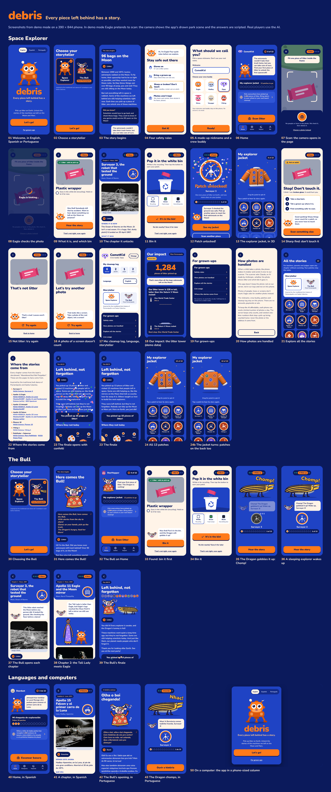

# Screenshots and recordings

The debris app on a phone (390 × 844, saved at 2× for sharp images), in English unless noted. See [`../FEATURES.md`](../FEATURES.md) for what each feature does.

**How these were made.** They come from the app's demo mode (`?demo`), so no real photos went to the AI and nothing was added to the real counts.

- **Scans are pretend.** In demo mode Eagle pretends to scan: the camera shows the app's own drawn park scene, and the answers come from a fixed list that covers every outcome. That is why a candy wrapper can be called "broken glass". Real players photograph real litter, and the AI decides.
- **The numbers are samples.** On Home and Impact the totals are demo sample data (1,284 pieces), labelled "Demo data" on Impact.
- **The demo-mode banner is hidden**, because players never see it.
- **The recordings are silent.** The app's sounds (the Bull's tune, the Dragon's chomp) and read-aloud don't show up in a screen recording.
- **Taps show as a white ripple.** It is added for the recordings only.

## Recordings

MP4 (H.264), 780 × 1688, 30 fps.

| Video | Length | What it shows |
|---|---|---|
| [`01-first-launch.mp4`](videos/01-first-launch.mp4) | 30 s | First launch: picking a language, choosing a storyteller, the opening story, the safety rules, a nickname and a crew buddy |
| [`02-space-round.mp4`](videos/02-space-round.mp4) | 34 s | One round with Space Explorer: scan, what was found, the chapter it unlocks, bin it, patch unlocked, the 3D jacket |
| [`03-bull-opening.mp4`](videos/03-bull-opening.mp4) | 20 s | The Bull dances in while his verse appears line by line |
| [`04-bull-round.mp4`](videos/04-bull-round.mp4) | 25 s | One round with the Bull: scan, bin it, the Dragon gobbles it up, a sleeping explorer wakes, the Bull opens the chapter |
| [`05-safety.mp4`](videos/05-safety.mp4) | 20 s | Safety: a sharp find ("Stop! Don't touch it."), something that isn't litter, and a photo of a screen |
| [`06-jacket-and-impact.mp4`](videos/06-jacket-and-impact.mp4) | 33 s | Spinning the explorer jacket, replaying a story from a patch, and the Impact litter tower |
| [`07-finale.mp4`](videos/07-finale.mp4) | 17 s | The finale after all 13 patches: every patch and a map of where the machines rest |
| [`08-portuguese-bull-round.mp4`](videos/08-portuguese-bull-round.mp4) | 16 s | The Bull's round in Portuguese |

## Screenshots

PNG, 780 × 1688. Files ending in `-full` show the whole screen, top to bottom.

### Space Explorer

| Screenshot | What it shows |
|---|---|
| [`01-welcome.png`](screenshots/01-welcome.png) | Welcome, in English, Spanish or Portuguese |
| [`02-choose-storyteller.png`](screenshots/02-choose-storyteller.png) | Choose a storyteller |
| [`03-opening.png`](screenshots/03-opening.png) | The story begins ([whole screen](screenshots/03-opening-full.png)) |
| [`04-safety-rules.png`](screenshots/04-safety-rules.png) | Four safety rules |
| [`05-nickname-and-crew-buddy.png`](screenshots/05-nickname-and-crew-buddy.png) | A made-up nickname and a crew buddy |
| [`06-home.png`](screenshots/06-home.png) | Home |
| [`07-scan.png`](screenshots/07-scan.png) | Scan: the camera opens in the page |
| [`08-eagle-is-looking.png`](screenshots/08-eagle-is-looking.png) | Eagle checks the photo |
| [`09-litter-found.png`](screenshots/09-litter-found.png) | What it is, and which bin |
| [`10-story-chapter-1.png`](screenshots/10-story-chapter-1.png) | The chapter it unlocks ([whole screen](screenshots/10-story-chapter-1-full.png)) |
| [`11-bin-it.png`](screenshots/11-bin-it.png) | Bin it |
| [`12-patch-unlocked.png`](screenshots/12-patch-unlocked.png) | Patch unlocked! |
| [`13-explorer-jacket.png`](screenshots/13-explorer-jacket.png) | The explorer jacket, in 3D ([whole screen](screenshots/13-explorer-jacket-full.png)) |
| [`14-sharp-find-dont-touch.png`](screenshots/14-sharp-find-dont-touch.png) | Sharp find: don't touch it |
| [`15-not-litter.png`](screenshots/15-not-litter.png) | Not litter: try again |
| [`16-photo-of-a-screen.png`](screenshots/16-photo-of-a-screen.png) | A photo of a screen doesn't count |
| [`17-me.png`](screenshots/17-me.png) | Me: cleanup log, language, storyteller ([whole screen](screenshots/17-me-full.png)) |
| [`18-impact.png`](screenshots/18-impact.png) | Our impact: the litter tower (demo data) ([whole screen](screenshots/18-impact-full.png)) |
| [`19-for-grown-ups.png`](screenshots/19-for-grown-ups.png) | For grown-ups |
| [`20-how-photos-are-handled.png`](screenshots/20-how-photos-are-handled.png) | How photos are handled |
| [`21-explore-all-the-stories.png`](screenshots/21-explore-all-the-stories.png) | Explore all the stories |
| [`22-where-the-stories-come-from.png`](screenshots/22-where-the-stories-come-from.png) | Where the stories come from |
| [`23-finale-confetti.png`](screenshots/23-finale-confetti.png) | The finale opens with confetti |
| [`23-finale.png`](screenshots/23-finale.png) | The finale ([whole screen](screenshots/23-finale-full.png)) |
| [`24-jacket-all-13-patches.png`](screenshots/24-jacket-all-13-patches.png) | All 13 patches |
| [`24b-jacket-back.png`](screenshots/24b-jacket-back.png) | The jacket turns: patches on the back too |

### The Bull

| Screenshot | What it shows |
|---|---|
| [`30-bull-choose-storyteller.png`](screenshots/30-bull-choose-storyteller.png) | Choosing the Bull |
| [`31-bull-opening.png`](screenshots/31-bull-opening.png) | Here comes the Bull! ([whole screen](screenshots/31-bull-opening-full.png)) |
| [`32-bull-home.png`](screenshots/32-bull-home.png) | The Bull on Home |
| [`33-bull-litter-found.png`](screenshots/33-bull-litter-found.png) | Found: bin it first |
| [`34-bull-bin-it.png`](screenshots/34-bull-bin-it.png) | Bin it |
| [`35-the-dragon-chomps.png`](screenshots/35-the-dragon-chomps.png) | The Dragon gobbles it up: Chomp! |
| [`36-an-explorer-wakes-up.png`](screenshots/36-an-explorer-wakes-up.png) | A sleeping explorer wakes up |
| [`37-bull-chapter-1.png`](screenshots/37-bull-chapter-1.png) | The Bull opens each chapter ([whole screen](screenshots/37-bull-chapter-1-full.png)) |
| [`38-bull-chapter-2-the-tall-lady.png`](screenshots/38-bull-chapter-2-the-tall-lady.png) | Chapter 2: the Tall Lady meets Eagle |
| [`39-bull-finale.png`](screenshots/39-bull-finale.png) | The Bull's finale ([whole screen](screenshots/39-bull-finale-full.png)) |

### Languages and computers

| Screenshot | What it shows |
|---|---|
| [`40-spanish-home.png`](screenshots/40-spanish-home.png) | Home, in Spanish |
| [`41-spanish-story.png`](screenshots/41-spanish-story.png) | A chapter, in Spanish |
| [`42-portuguese-bull-opening.png`](screenshots/42-portuguese-bull-opening.png) | The Bull's opening, in Portuguese |
| [`43-portuguese-the-dragon-chomps.png`](screenshots/43-portuguese-the-dragon-chomps.png) | The Dragon chomps, in Portuguese |
| [`50-desktop.png`](screenshots/50-desktop.png) | On a computer: the app in a phone-sized column |
